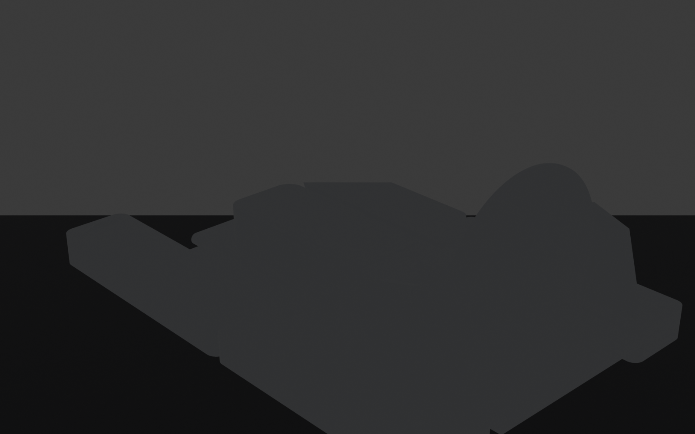
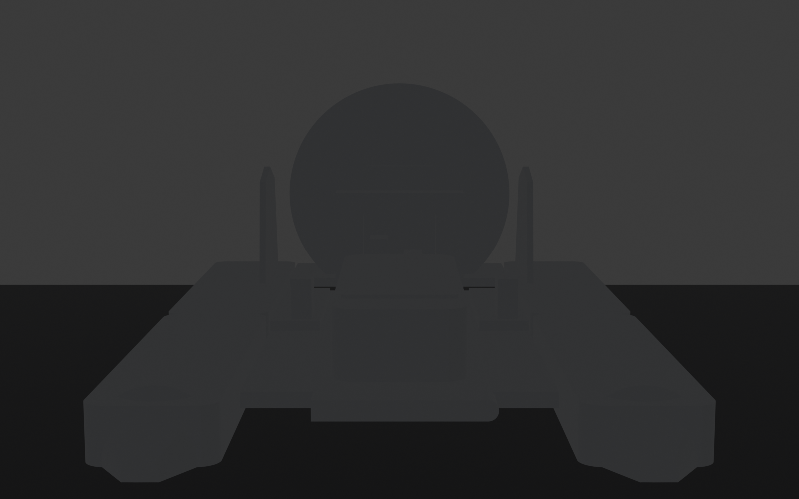

# Hydrofoam Final Master

Modulares RC-Hydrofoam für FDM-Druck mit PLA und PETG.

## Konstruktion v01

Erster Engineering-Blockout zur Prüfung von Proportionen, Modulgrenzen, Antrieb, Akku- und Servo-Bauräumen. Die Form ist noch nicht der finale Oberflächenstand.

### Isometrisch

### Draufsicht

### Seitenansicht

### Frontansicht

## Aktuelle Konstruktionsziele
- ca. 450-mm-Klasse
- modular und reparierbar
- Bambu Lab P2S, 0,4-mm-Düse
- ausschließlich PLA und PETG
- 3S 1500-2200 mAh
- erhöhter Pusher-Antrieb mit Leistungsreserve
- getrennte Ailerons, Pitch-Steuerfläche und Twin-Rudder
- austauschbare PETG-Kufen für Wasser, Rasen und festen Sand

## Hinweis
v01 ist bewusst ein Engineering-Blockout. Nachfolgende Versionen werden geometrisch gegen den verbindlichen Final-Master weiterentwickelt.
