# Hydrofoam Final Master

## EINZIGER VERBINDLICHER FINAL MASTER

**Dieses Originalbild ist die einzige verbindliche Designvorlage.** Keine CAD-Visualisierung, keine automatisch generierten Bilder und keine aelteren Silhouettenmasken ersetzen es.

[Master-Sperre mit Pruefsumme und Merkmalen](docs/FINAL_MASTER_LOCK.md) | [Original als JPEG](reference/FINAL_MASTER_ORIGINAL.jpeg)

**SHA-256:** `a4d3199bae23965fbd9e3c7f761e8e55e2911e5634889f670fea32a92b7007fd`

---

Futuristisches modulares RC-HydroFoam nach dem verbindlichen Final-Master-Mockup.

## VERBINDLICH: LAND + WASSER + LUFT

**Hydrofoam ist ein Dreimoden-Modell, kein reines Wasserfahrzeug.**
Es muss eigenstaendig auf Land (auch Kurzrasen/tragfaehiger Sand), auf Wasser mit Gleit-/Foilfahrt und in der Luft funktionieren. Die sichtbare Form des [unveraenderten Final Masters](reference/FINAL_MASTER_ORIGINAL.jpeg) bleibt dabei verbindlich.
Technische Einzelheiten, Risiken, Unterseitenkufen, Bodenkontakt, Foil-Bodenfreiheit und separate Abnahmetests: [LAND_WATER_AIR_REQUIREMENTS.md](docs/LAND_WATER_AIR_REQUIREMENTS.md).

**Status v306:** Diese Funktionen sind noch nicht nachgewiesen. Kein Final-Release.

<!-- CURRENT_CONSTRUCTION_RENDER_START -->
## Aktueller Konstruktionsstand: v328 (WIP)

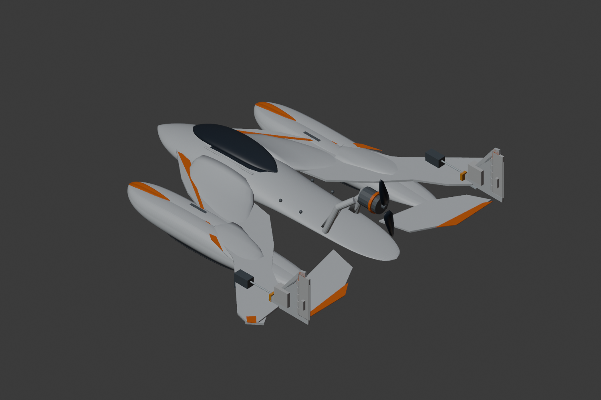

**Bauabschnitt 01:** Je Leitwerksseite 5 wechselweise zugeordnete Scharnierhuelsen und ein Achsreferenz-Pin. 10/10 Huelsen haben geschlossene Mesh-Topologie. **Huelsen sind noch nicht tragend mit Flosse/Ruder verbunden, Achsen und Spiel nicht validiert.** [QA v328](docs/V328_RUDDER_HINGE_QA.json). [Bauabschnitte](docs/BUILD_SECTIONS_TO_FINAL.md).

Original-Final-Master-Bild unveraendert. LAND/WASSER/LUFT noch nicht abgenommen.

<!-- CURRENT_CONSTRUCTION_RENDER_END -->

## Aktueller technischer Modellstand: v305 (WIP)

**Blender-Gesamtbaugruppe, noch keine Final-/Flug- oder Druckfreigabe.**
Der Maßstab, das äußere Design und die lackierte Silhouette werden ausschließlich an [FINAL_MASTER_ORIGINAL.jpeg](reference/FINAL_MASTER_ORIGINAL.jpeg) gemessen.

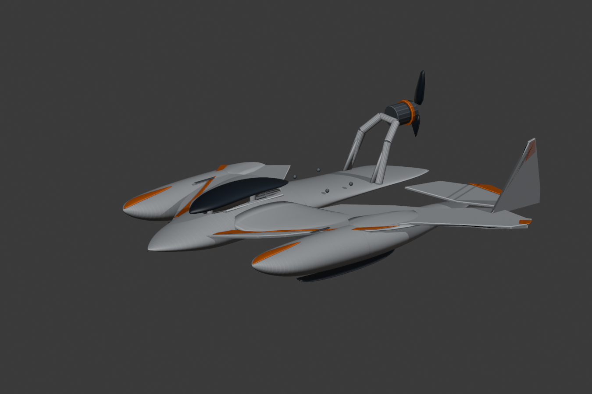

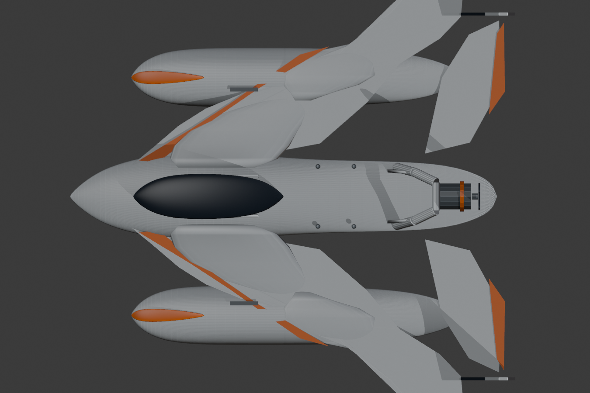

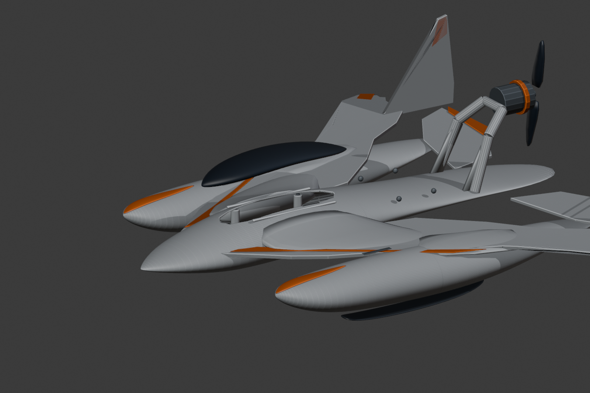

[CAD-Schnittstudie, Leichtbau- und Mesh-Prüfbericht v305](docs/V305_MODEL_PROGRESS.md)

---

## Historischer Vergleichsstand v288 (nicht Final)

**Version:** v288_BOTTOM_FIT_CLEAN - 3D-Formmodell, optisch noch nicht final`r`n### Isometrisch
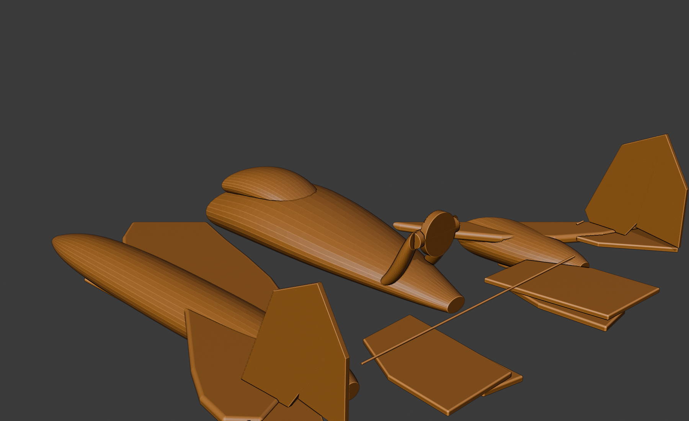

### Draufsicht
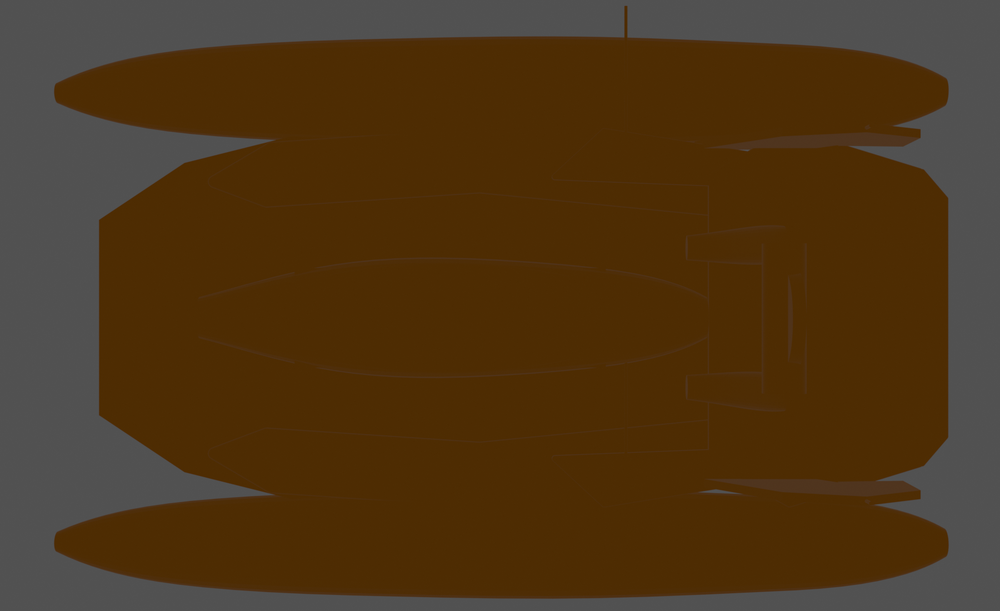

### Seitenansicht
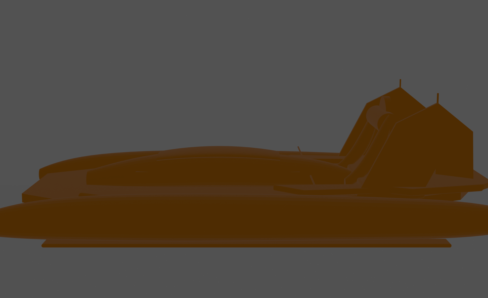

### Frontansicht
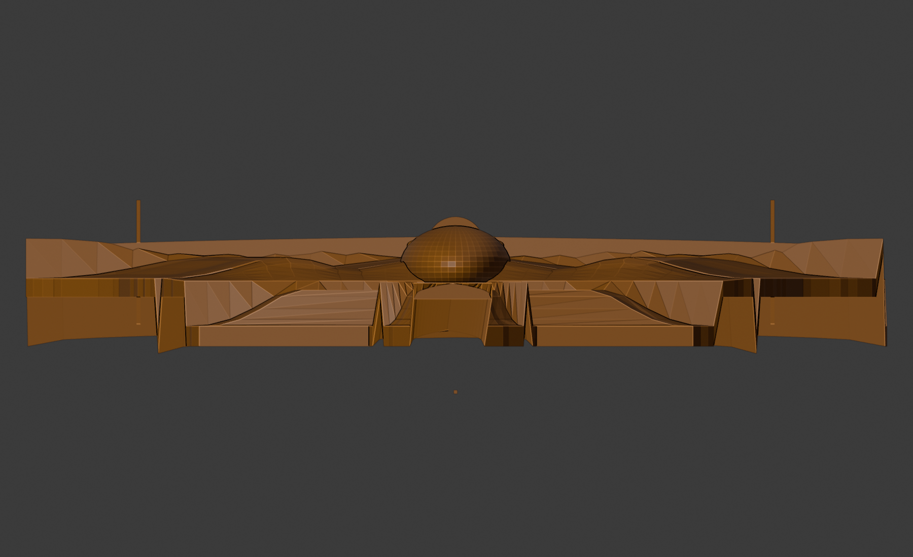

### Master-Hero-Vergleich
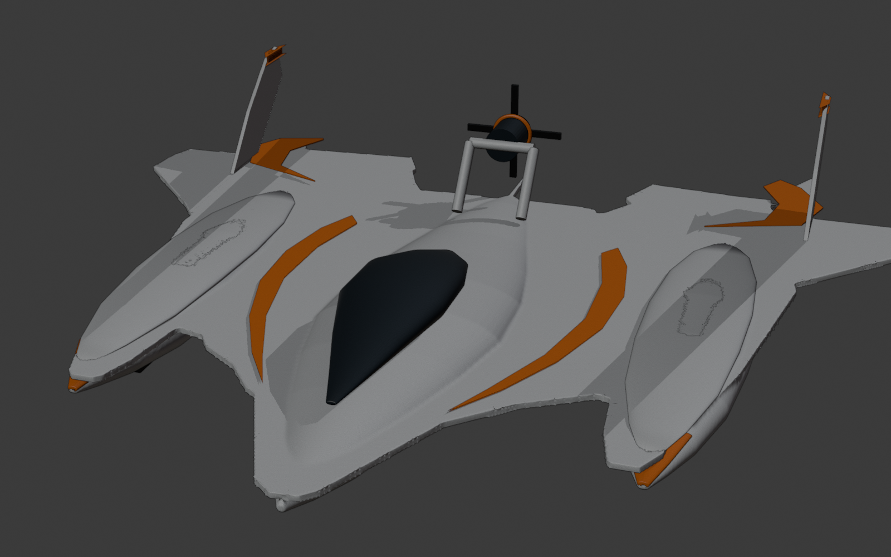

## Konstruktionsziele
- sichtbare Außenform folgt dem Final-Master-Mockup
- Ziel-AUW 600–625 g mit 3S 2200 mAh
- harte MTOW-Grenze 650 g
- 3S / SunnySky X2212 2450KV / APC 6x4 / 40-A-ESC
- vier JX PDI-1109MG-Klasse Servos
- modular druckbar auf Bambu Lab P2S
- ausschließlich PLA und PETG als Filamente
- austauschbare PETG-Kufen für Wasser, Rasen und festen Sand

## Versionierte Konstruktionsbilder
Ältere Stände bleiben unter `docs/construction-images/vXX/` erhalten. Die README referenziert ausschließlich `current/`, damit auf GitHub immer der aktuell beste gemessene Stand sichtbar ist.

## Aktuelle technische Basis
Siehe `docs/ENGINEERING_CALCS_v02.md`.

## Master-Overlay

**Top:** Ziel grün, CAD rot, Überdeckung gelb.

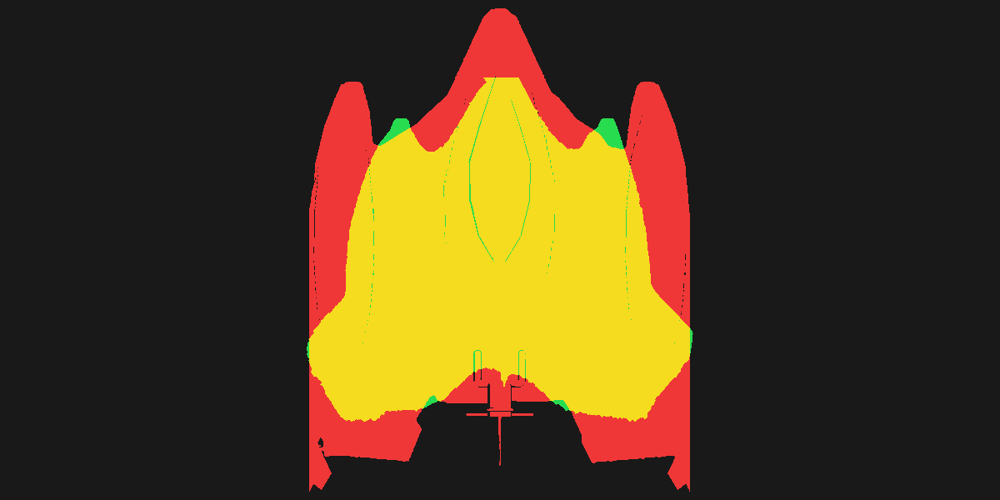

**Side:**

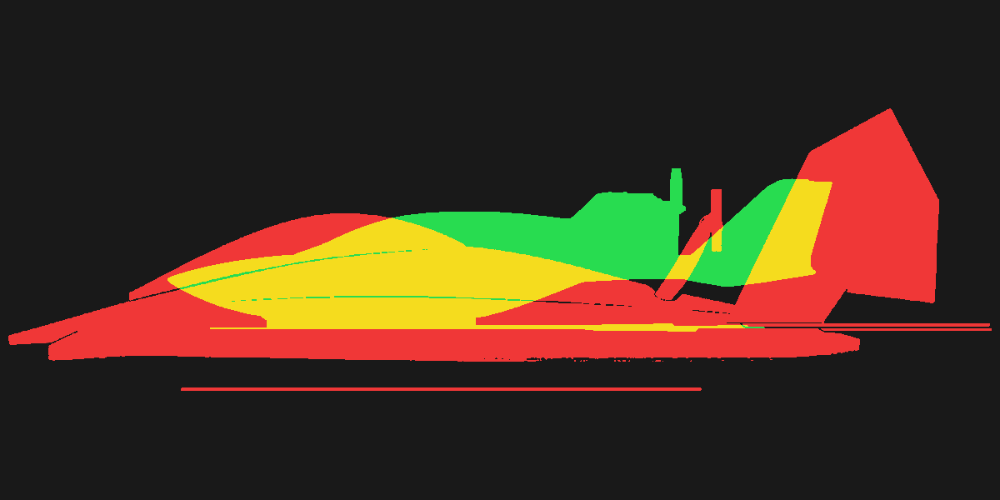

## Engineering-Workflow: FreeCAD + Blender

**Verbindlich ist der Original-Final-Master.** FreeCAD definiert die parametrische Unterwassermechanik und die Befestigungs- und Dichtungsschnittstellen; Blender modelliert die optisch verbindliche organische Rumpf-/Tragflächenform.

- [Vollständige Schritt-für-Schritt-Anleitung für FreeCAD, Blender, Hydrofoils, Elektronikbox, Antrieb und GitHub](docs/WORKFLOW_FREECAD_BLENDER.md)
- Status: **Entwicklung**. Die aktuellsten Konstruktionsexperimente dürfen nicht mit freigegebenen Final-Master-Bildern oder druckfertigen Baugruppen verwechselt werden.
- Der Bambu Lab P2S bietet 256 x 256 x 256 mm Bauraum. Für reale Druckfreigabe sind Slicer-Platzierung und Material-/Festigkeitsprüfung erforderlich.