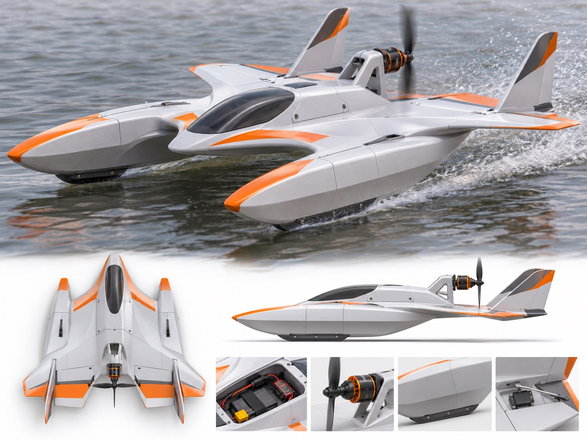

# HYDROFOAM: VERBINDLICHER FINAL MASTER

**Originaldatei:** `reference/FINAL_MASTER_ORIGINAL.jpeg`

## Herkunft und Integritaet

- Direkt vom Nutzer erneut am 2026-11-08 hochgeladene Originalgrafik.
- Exakter Bit-fuer-Bit-Abgleich mit der lokalen Datei auf Jens-PC anhand von SHA-256.
- Dateigroesse: **438726 Bytes**, Bildmasse: **1448 x 1086 Pixel**, Dateiformat **JPEG**.
- SHA-256: `a4d3199bae23965fbd9e3c7f761e8e55e2911e5634889f670fea32a92b7007fd`.
- Die Datei ist unveraendert zu bewahren. Kein Umbenennen, Komprimieren, Hochskalieren, Uebermalen oder Ersetzen im selben Pfad.

## Visuelle Pflichtmerkmale

1. Zentraler, elegant zugespitzter Bug mit dunkler, langer und flacher Cockpitkanzel.
2. Zwei parallel seitlich angeordnete laengliche Schwimmer, deren Bugspitzen gegenueber der zentralen Bugspitze nach hinten versetzt sind.
3. Markant geschwungene, zur Mitte weich uebergehende Fluegel mit exakt der orange-weissen Grafik aus dem Master.
4. Zwei aufragende, nach hinten gepfeilte aeussere Heckleitwerke mit dunkler Flaeche und orangefarbenen Spitzen.
5. Auf einem hochgesetzten offenen Traeger montierter Heck-Pushermotor mit schwarzem Propeller.
6. Schwarze unterseitige Kufen an den beiden Schwimmern, sichtbare Wartungsfugen, Elektronikfach und Heckrudertechnik.
7. Das Originalblatt enthaelt eine Hauptansicht auf Wasser, eine Draufsicht, eine Seitenansicht sowie Detailansichten. Alle sind Teil **derselben** verbindlichen Referenz.

## Strikte Entwicklungsregel

**Nur dieses Bild ist der Design-Final-Master.** Alte Ableitungen unter `docs/construction-images/current/master_hero.png`, CAD-Renderings, v4-Silhouettenmasken und neu erzeugte Bildvorschlaege sind **nicht** der Master. Sie duerfen fuer Analyse und Formvergleiche verwendet werden, aber niemals das Original ersetzen.

**Jede** Blender-/FreeCAD-Revision muss gegen die Sichtmerkmale dieses Originals geprueft werden. Die Aussenform wird nicht eigenmaechtig geaendert. Nicht sichtbare Mechanik, Foils, Bauraeume und Stabilitaetsdetails werden konstruktiv ergaenzt und als technische Annahmen kenntlich gemacht.

**Freigabe:** Die bisherige v298/v300-WIP-Geometrie ist nicht fotogetreu bestaetigt. Kein Final-Status, solange das Ergebnis nicht nachweislich mit dem Original uebereinstimmt und die mechanische, Druck- und Funktionstauglichkeit nachgewiesen sind.
