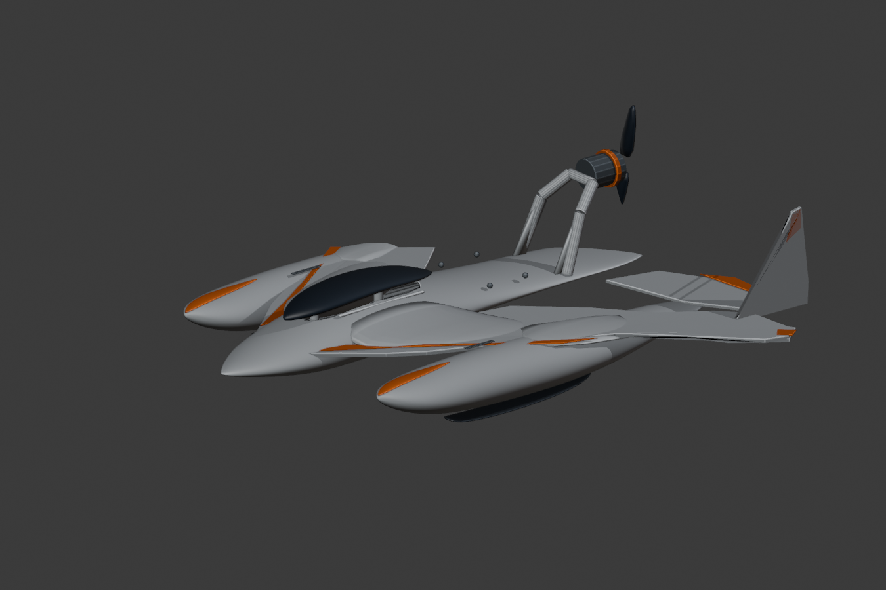
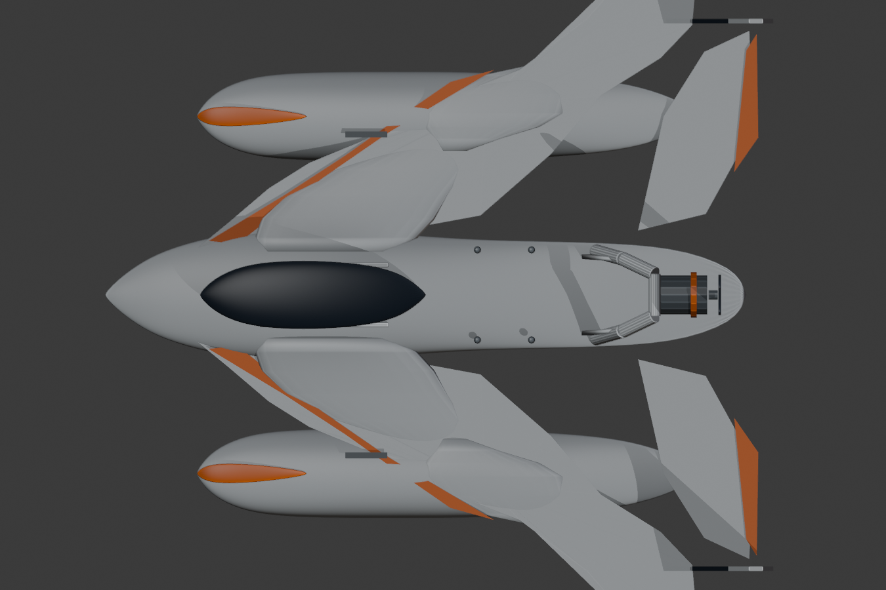
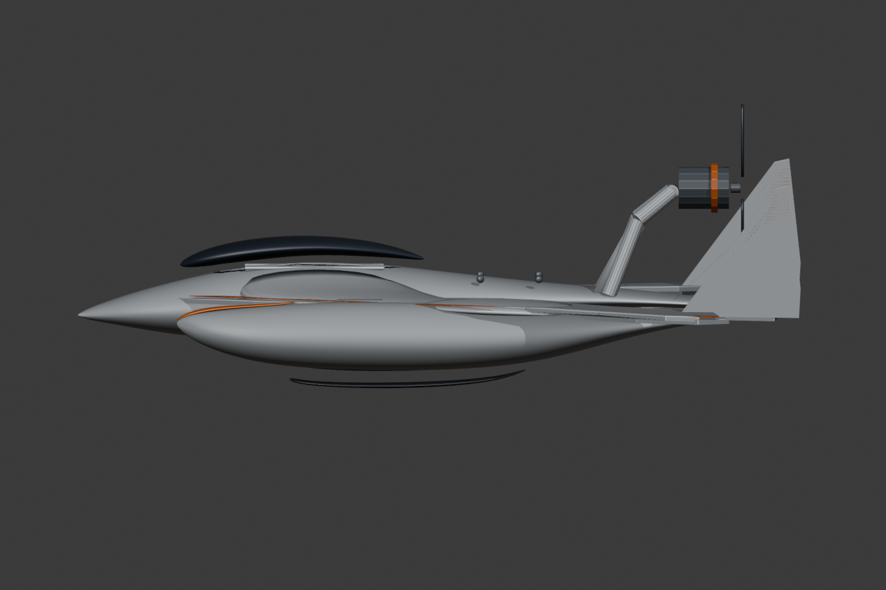
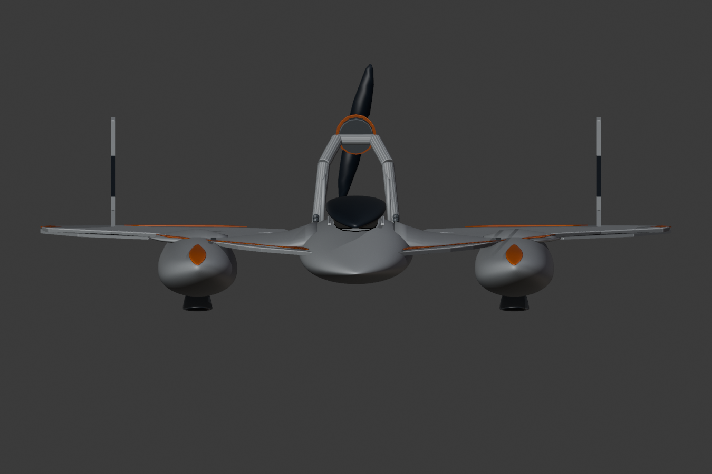
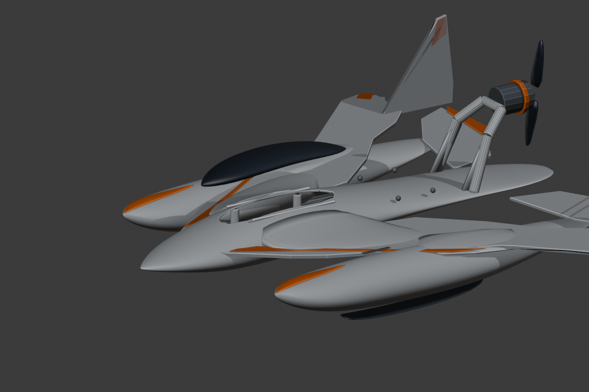

# Hydrofoam v303 | Echte CAD-Leichtbauiteration

**Designreferenz:** unveränderte `reference/FINAL_MASTER_ORIGINAL.jpeg` (SHA-256 `a4d3199bae23965fbd9e3c7f761e8e55e2911e5634889f670fea32a92b7007fd`). **Status:** WIP, nicht final, nicht flug- oder druckfreigegeben.

## Nachweisbare Konstruktionsänderungen

- v301: Tatsächliche Cockpitöffnung aus dem Zentralrumpf geschnitten, abnehmbare Kanzel von unten ausgehöhlt; separate Flanschauflagen und Befestigungsdome; innere Verstärkungsstege an Motorträger.
- v302: Erste geschlossene Hohlräume in Zentralrumpf und beiden Schwimmern. Unabhängige STL-Prüfung fand jedoch zwei nicht-manifold Kanten am Zentralrumpf-Heck und zwei Nullflächen an der Kanzel. **v302 nicht freigegeben**.
- v303: Heckseitige Hohlkammer verkürzt, sodass der Zentralrumpf als STL geschlossen bleibt. Zwei Nullflächen aus dem separaten Kanzel-STL entfernt. Unabhängige Prüfung aller vier Bauteile bestanden.

| STL | Volumen (mm³) | PLA-Volumenmasse bei 1,24 g/cm³ | Watertight | Bauraum 256 mm |
|---|---:|---:|---|---|
| central_hull_shell | 88.931 | 110,27 g | ja | **nein**, Länge 426,99 mm |
| left_float_shell | 44.541 | 55,23 g | ja | **nein**, Länge 333,52 mm |
| right_float_shell | 44.541 | 55,23 g | ja | **nein**, Länge 333,52 mm |
| removable_smoked_canopy | 40.446 | 50,15 g | ja | ja |

**Achtung:** Die angegebenen PLA-Massen sind geometrische Vollmaterial-Schätzungen für die jeweiligen bereits ausgehöhlten Körper, keine gemessenen Slicer-Massen. Die gesamte RC-Baugruppe mit weiteren Tragflächen, Foils, Klebstoff, Schrauben, Motor, Akku und Servos ist noch nicht bilanziert.

Die tatsächliche Einsparung gegenüber den vorigen massiven Körpern beträgt beim Zentralrumpf ca. **83,86 %**, bei den Schwimmern je ca. **89,36 %** bezogen auf deren geometrisches Volumen. Das ist **kein** Nachweis ausreichender Wandstärke oder Festigkeit. Der Cockpit-Zugang ist noch nicht wasserdicht. Ein abnehmbarer Deckel benötigt O-Ring/Flansch, Anschläge und Befestigungsprüfung.

## Offene Blocker

1. Formabweichungen gegenüber dem Originalbild: Flügel-Rumpf-Übergänge, Haubenlinie und Heckmotorträger noch nicht fotogetreu. Die README-Masterbilder bleiben unverändert.
2. Zentralrumpf und Schwimmer in **druckbare, geschlossene und steckbare** P2S-Module segmentieren; Schnittflächen, Verbinder, Ausrichtung, Lastpfad und Dichtung prüfen.
3. Tatsächliche FDM-Slicer-Massen, Druckbarkeit, Wandstärken, Schwerpunkt und Auftrieb im Wasser bestimmen.
4. Foil-/Strut-Aufnahmen, 3S-Antrieb, Servo-/Rudermechanik, Elektronikbox und Dichtigkeitsnachweis fehlen als fertig validierte Baugruppen.

**Nachweise:** `docs/V303_SHELL_AUDIT.json`, `scripts/build_v301_canopy_access.py`, `scripts/build_v303_lightweight_shells.py`, `scripts/audit_and_repair_v303.py`, `renders/v303/`, `print/v303_shell_prototypes/`.
