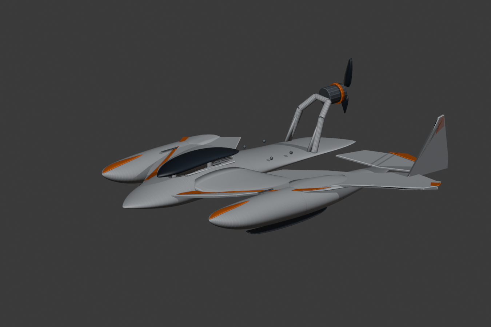
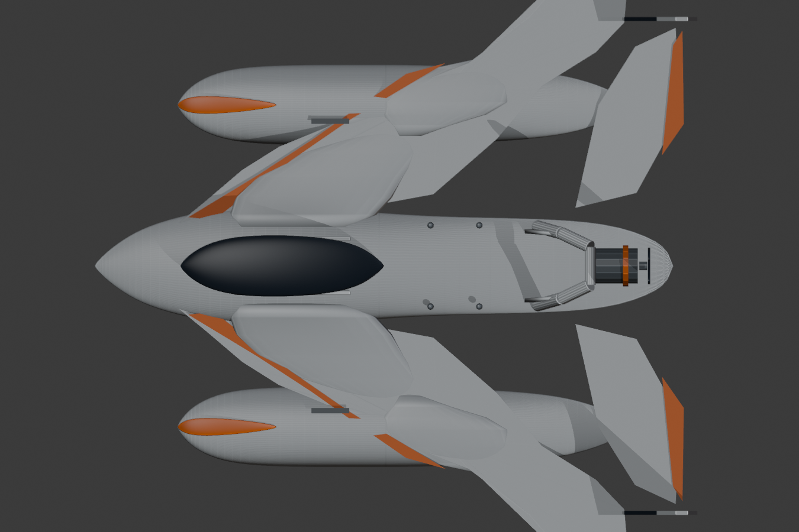
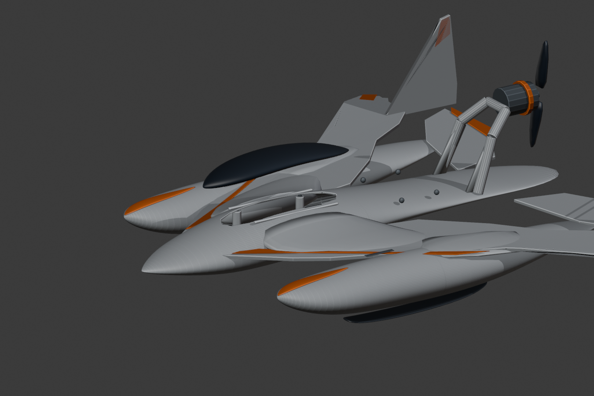

# Hydrofoam v301 bis v305: Cockpit, Hohlschalen und P2S-Segmente

**Status:** technisch fortgeschrittener **WIP**, ausdrücklich **nicht** Final-Master-konform und **nicht** druck-/flugfreigegeben.

**Einzige Designvorlage:** [Original FINAL MASTER](../reference/FINAL_MASTER_ORIGINAL.jpeg). SHA-256: `a4d3199bae23965fbd9e3c7f761e8e55e2911e5634889f670fea32a92b7007fd`.

## Tatsächliche Geometrieänderungen

- **v301**: reale rechteck-/oval verlaufende Cockpitöffnung im Zentralrumpf, innen ausgehöhlte separat abnehmbare dunkle Kanzel, Aufnahmeleisten, Befestigungsbossen, motorseitige Strebenverstärkungen. Die noch nicht spezifizierte Akku-Hüllkörper-Referenz ist ausdrücklich in Blender verborgen und nicht zum Drucken bestimmt.
- **v302**: geschlossene Hohlkammern innerhalb von Zentralrumpf und den zwei Schwimmern bei weitgehend unveränderter äußerer Form. Beim unabhängigen Export traten allerdings fehlerhafte Kanten im Zentralrumpf und in der Kanzel auf. **v302-STLs nicht freigeben.**
- **v303**: den inneren Rumpfhohlraum heckwärts verkürzt; Nullflächen und verwaiste Dreiecke bereinigt. Unabhängige Trimesh-Prüfung: **4/4 Einzelkörper watertight und winding-consistent**.
- **v304**: drei Hohlkörper bei X = -15 mm (Zentralrumpf) bzw. X = -10 mm (je Schwimmer) geteilt. Zwei der sechs Stl-Exporte zeigten nicht geschlossene Kanten. **v304-STLs nicht freigeben.**
- **v305**: sechs Hauptmodule aus dem v304-Schnitt geometrisch bereinigt und vier bereits geprüfte Hauptflügel-Module aus v298 in eine zusammengebaute Blender-Datei integriert. **63 sichtbare physische Mesh-Objekte**, 10 separate große P2S-Segmente.

## Verifizierte Leichtbau-Materialvolumina (keine echten Waagewerte)

| Teil | Referenzvolumen aus v303 STL | Rechengewicht bei PLA 1,24 g/cm³ |
|---|---:|---:|
| Zentralrumpf-Schale | 82.220 mm³ | 101,95 g |
| Linker Schwimmer | 44.541 mm³ | 55,23 g |
| Rechter Schwimmer | 44.541 mm³ | 55,23 g |
| **Drei Hohlkörper zusammen** | **171.302 mm³** | **212,41 g** |
| Gesonderte dunkle Kanzel | 40.446 mm³ | 50,15 g |

Wichtig: Das ist eine aus Dreiecksvolumina und angenommener **Materialdichte** berechnete theoretische Masse, nicht das tatsächliche FDM-Druckgewicht. Druckprofile, Infill, Perimeter, Randverstärkungen, Stützen, Kleber, Kufen, Akku, Motoreinheit, Servo und andere Bauteile sind nicht einbezogen.

## QA

- v303 zentrale Hohlschale, beide Schwimmer und Kanzel: **4/4 Watertight / winding consistent**.
- v305: **6/6 Hohlrumpf-Segmente Watertight / winding consistent**, jeweils unter 256 mm pro Einzelachse. Module befinden sich als STL in `print/v305_clean_p2s_shell_modules/`.
- Die **4 Haupttragflächen-Module v298** wurden bereits auf Volumenerhaltung, Wasserdichtigkeit und P2S-Größenprüfung getestet.
- Geometrische Modulgrenzen sind keine bestätigten Druckplatten-Belegungen; Stützen, Druckrichtung und Brim fehlen weiterhin.
- Die Modellhülle wird derzeit nach bildlicher Außenform abgeschätzt. Ein numerischer Foto-Overlay-Abnahmewert gegen die Originalperspektive fehlt weiterhin.

## Bilder aus dem echten Blender-Modell

## Offene Final-Abnahmen

1. Außenhaut und Master-Silhouette originalgetreu nacharbeiten, insbesondere fließende Verbindung der beiden Schwimmer, Rumpf und Tragflächen.
2. Modulverbindungen mit nachgewiesenem Lastpfad. Vorhandene v300-Verbinder bleiben Entwurfsprototypen und sind mechanisch nicht abgenommen.
3. Reale Maße des 3S-Akkus, 3S-ESC, Motor, Servos, Schwerpunkt und Gesamtabfluggewicht verifizieren.
4. Mechanisch funktionsfähige Unterwasserfoils samt Struts in FreeCAD konstruieren. Auf dem Masterbild sind deren Maße/Profil nicht sichtbar.
5. Dichtungsflächen, wasserdichte Elektronikbox, Druckpfade, P2S-3MF-Projekte, Montagefolge und Lasttests umsetzen.
6. Gleitfahrt, Foil-Fahrt und Freiflug getrennt untersuchen und testen. **Keine finale Flugfreigabe.**
