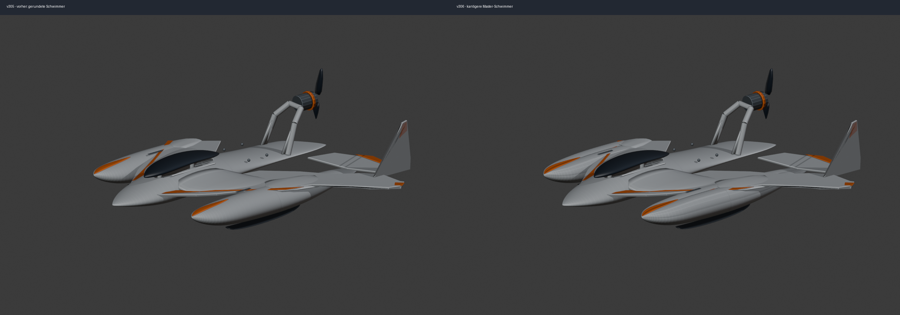
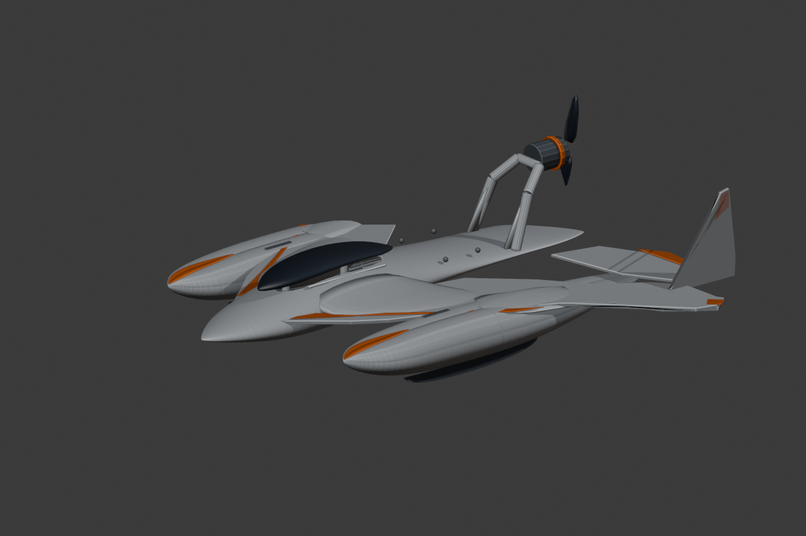
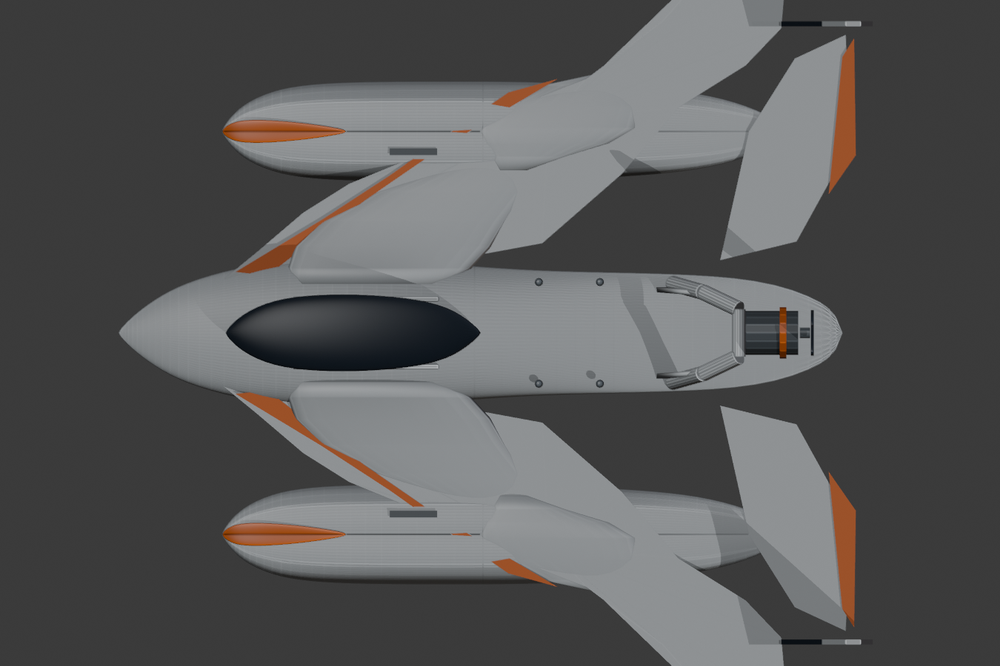
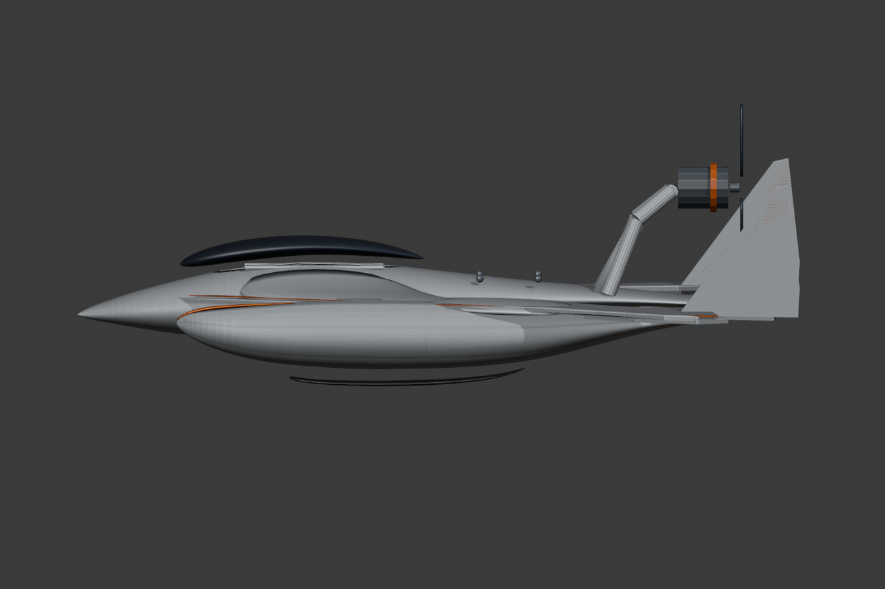

# Hydrofoam v306 | Kantigere Schwimmer nach Original-Final-Master

**Datum:** 2026-11-08. **Status:** Entwicklungsstand, keine Final- oder Druckfreigabe.
**Einzige Bildreferenz:** [Unveraendertes Original](../reference/FINAL_MASTER_ORIGINAL.jpeg), SHA-256 `a4d3199bae23965fbd9e3c7f761e8e55e2911e5634889f670fea32a92b7007fd`.

## Geometrische Aenderungen gegen v305

- Beide Schwimmer direkt am realen Blender-Mesh geaendert, **keine** Bildgenerierung.
- Bisher elliptisch-runde Schwimmerquerschnitte in explizite gebrochene Abschnittskonturen mit flacher Oberseite, abgesetzter Schulter und definierter unterer Chine/Knickkante ueberfuehrt.
- Langer Bug, Rueckversatz, +/-119 mm Seitenposition, Heck, Proportionen der restlichen Mittelrumpf-/Fluegel-/Leitwerks- und Motorbaugruppen unangetastet.
- Orange Bugstreifen und schwarze unterseitige Kufen nach derselben Querschnittstransformation mitgefuehrt.
- 8 Objekte geometrisch veraendert; maximale lokale Verschiebung der vier Schwimmersegmente ca. 3.40 mm; Maximalverschiebung der Orange-Streifen 0.91 mm.
- Original v305 erhalten, v306 separat gespeichert.

## Pruefungen

- **4/4** einzelne Schwimmer-STLs: watertight, konsistente Normalen, max. Einzelachse unter 256 mm.
- Gemeinsame Trennebene bei X=-10 mm: links/rechts je 175 gemeinsame Schnittkonturpunkte, **keine** abweichenden Punkte auf 0.001 mm gerundet.
- Vergleich zu v305: Schwimmer-Schalenmaterialvolumen von ca. 44545/44543 mm3 auf 46507/46505 mm3, **+4.40 %** je Schwimmer. PLA-Vollmaterial-Massenmehrbedarf bei 1.24 g/cm3 ungefaehr **+2.43 g je Schwimmer**, also +4.87 g zusammen, nicht auf der Waage gemessen.
- Der Schritt hin zu einer kantigeren Schulter ist qualitativ im CAD-Vorher/Nachher sichtbar. **Keine** quantitative Verbesserung gegen Foto-Master gemessen; Foto-Overlay und mechanische Lastpfade bleiben offen.

## Echte CAD-Bilder

## Neue Dateien
- `cad/Hydrofoam_Final_Master_v306_FACETED_MASTER_FLOATS.blend`
- `print/v306_faceted_float_modules/float_{left,right}_{front,rear}.stl`
- `scripts/build_v306_faceted_floats.py`, `scripts/render_v306_workbench.py`
- `scripts/audit_v306_floats.py`, `scripts/compare_v306_floats.py`
- `docs/V306_FACETED_FLOAT_AUDIT.json`, `docs/V306_FACETED_FLOAT_COMPARISON.json`

## Weitere konstruktive Hindernisse

1. Exakte kantige Bug- und Oberseitenform noch enger mit dem Foto-Master abgleichen, aber Bild-Silhouette nicht eigenmaechtig veraendern.
2. Wandel der Querschnittsgeometrie auf Mindestwandstaerken untersuchen, insbesondere auf Innenschalen und Bugnaht.
3. Passende mechanische Verbindungen, Abdichtung und Wasserlasten in den P2S-Modulstoessen nachweisen.
4. Fluegel-/Schwimmeranschluesse optisch und konstruktiv weiter glatten, waehrend Schwimmer-Chine erhalten bleibt.
5. Gesamtmasse mit Akku, Servos, Motor, Unterwasserfoils und Masten sowie echte Druckpfade/Freiflug-/Foil-Abnahme pruefen.

Die README-Hauptbilder bleiben unveraendert, bis eine belegte Foto-Master-Verbesserung nachgewiesen ist.
