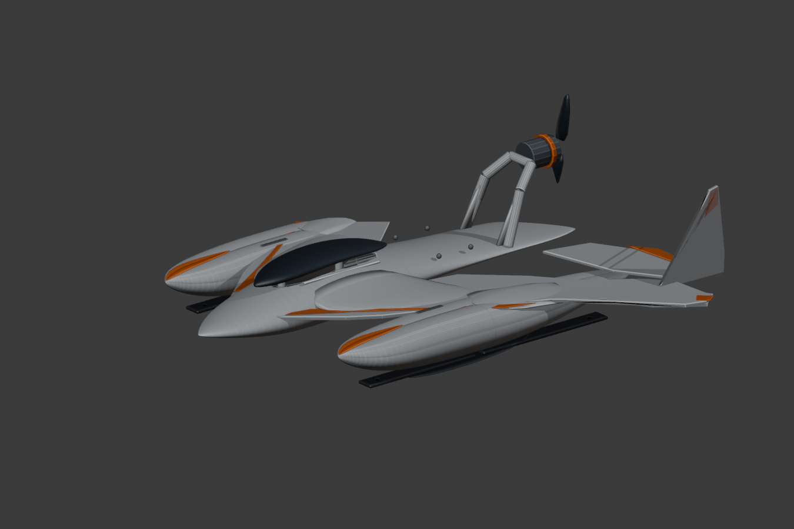
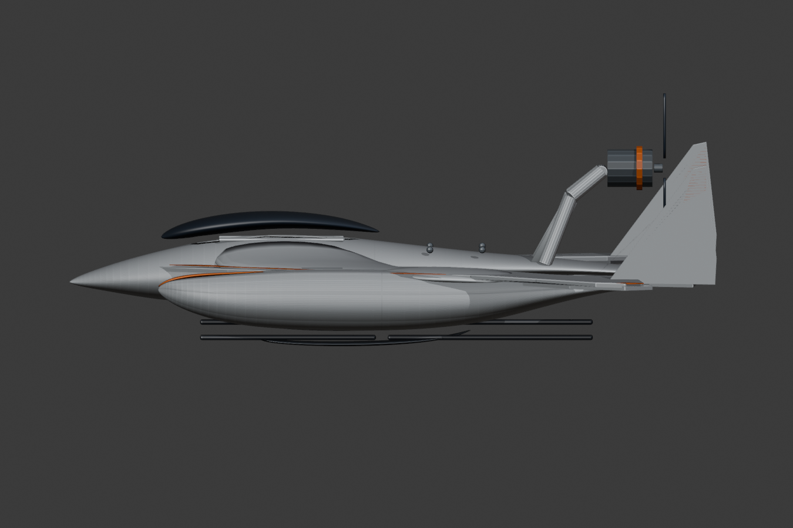

# Hydrofoam v307: abnehmbare Landkufen (Prototyp)

**Stand:** 2026-11-08. Nur Entwicklungsstand; keine Fahr-, Wasser- oder Flugfreigabe.

Ausgehend von v306 wurde die CAD-Baugruppe um **vier echte separate PETG-Landkufen** erweitert: je eine vordere und hintere Kufe unter beiden kantigen Master-Schwimmern. Das Original-Final-Master-Bild wurde nicht veraendert. Die sichtbare Hauptkontur wurde nicht neu entworfen.

## Geometrie

- Vier austauschbare, schwarz materialisierte PETG-Kufenplatten, Laengen **121 und 141 mm**, Breite **17 mm**, Dicke **3.2 mm**, verrundete Kanten 1.5 mm.
- Je zwei vertikale **3.3 mm**-Durchgangsbohrungen fuer M3-Schrauben, je 15 mm vom jeweiligen Kufenende. Acht Bohrungen insgesamt.
- Zentriert bei y = +/-119 mm; z = -9.3 mm; Kufenunterseite z = -10.9 mm.
- Kufen sind **separate Prototypteile** und aendern die v306-Schwimmer nicht. Das vorhandene Schwimmermodell enthaelt **noch keine passenden Gewindeeinsaetze, Dichtungen oder Montageaufnahmen**.
- Geometrische Teilvolumina: zweimal 6215.84 mm3 und zweimal 7258.84 mm3 = **26949.36 mm3**. Bei angenommener PETG-Dichte 1.27 g/cm3 ca. **34.23 g** zusaetzliche Vollmaterialmasse; tatsaechliche Slicer-/Druckmasse unbekannt.

## QA

- **4/4** STL-Teile wasserdichte, konsistent orientierte Meshes; je 1 Zusammenhangskomponente.
- **4/4** Teile passen geometrisch in den P2S-Bauraum; maximale Achse 141 mm.
- Bohrungen sind im Mesh per Boolean geschnitten, aber Schraubenfestigkeit, Einbettung in Schwimmer, Lastpfad, Reibung, Verschleiss, Bodenfreiheit, Sand- und Rasenfahrt **nicht geprueft**.
- Die Lage unter den Schwimmern ist eine **vorlaeufige Montageposition**, keine bestaetigte Kontakt-/Kollisionsfreiheit. Vor Produktion Oberflaechenabstand gegen den originalen v306-Schwimmer und Schraubenfreiheit pruefen.
- Die Wasserfoils haben noch keine nachgewiesene Boden-Schutzstellung. Ein Bodentest mit montierten ungeschuetzten Foils waere nicht freigegeben.
- Der hochliegende Pusher-Antrieb, 3S-Schub und die Lenkung auf Land sind weiterhin nicht abgenommen.

## Dateien

- `cad/Hydrofoam_Final_Master_v307_LAND_SKID_PROTOTYPES.blend`
- `print/v307_land_skid_prototypes/land_skid_{left,right}_{front,rear}.stl`
- `scripts/build_v307_land_skid_prototypes.py`
- `scripts/audit_v307_land_skids.py`
- `scripts/render_v307_workbench.py`
- `docs/V307_LAND_SKID_QA.json`

**Naechste Aufgabe:** Schwimmer-Kufen-Kontakt/Kollision rechnerisch pruefen; passgenaue, dichtbare M3-Gewindeeinsatz-Bosse und Schraubenlaengen konstruieren, erst danach Belastungs- und Abriebtests. Fuer Kurzrasen und Sand kann eine reine Gleitkufe trotz korrekter CAD-Geometrie unzureichend sein; Fahrwerkskonzept getrennt validieren. README-Masterbilder bleiben unveraendert.
