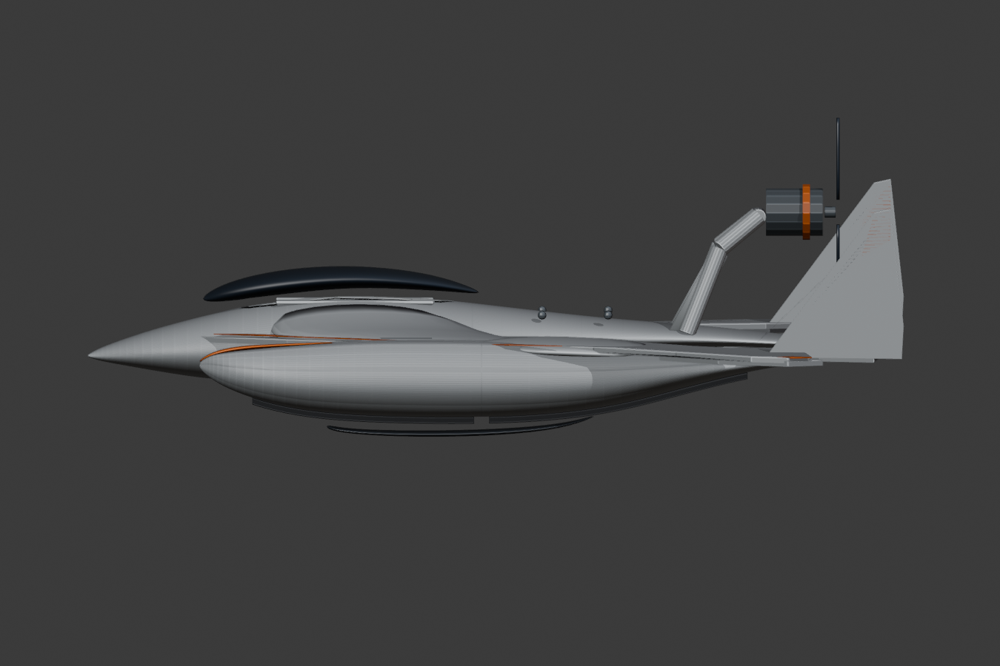

# Hydrofoam v308 – Schwimmerangepasste PETG-Kufen

**Datum:** 2026-11-09. **Status:** Konstruktionsprototyp, keine Land-/Wasser-/Flugfreigabe.

Verbindliches Originalbild: [FINAL_MASTER_ORIGINAL.jpeg](../reference/FINAL_MASTER_ORIGINAL.jpeg). Ziel bleibt **Land + Wasser + Luft**, der alte v307-Flachkufenentwurf ist nur Versuchsversion.

## Festgestellter v307-Montagefehler

Die v307-Kufen lagen mit konstanter Oberseite Z=-7.7 mm unter der gekrümmten Unterseite der Schwimmer. Eine konservative zufällige Oberflächenprobe zeigte minimale Oberflächenabstände von ca. **3.14 bis 3.85 mm**. Eine exakte vertikale Dreiecksstrahl-Abfrage an den M3-Bohrpunkten ergab dagegen **acht** Einzelstellen:
- Beide vorderen, bugseitigen Schrauben: **9.66 mm** senkrechter Spalt.
- Beide vorderen, heckseitigen Schrauben: **3.15 mm**.
- Beide hinteren, bugseitigen Schrauben: **3.89 mm**.
- Beide hinteren, heckseitigen Schrauben: **24.26 mm**.

Deshalb waren die v307-Schrauben nicht realistisch in die Schwimmer abgestützt. Standoffs dieser Länge ohne strukturelle Anbindung wären eine schlechte Dauerlösung.

## Reale v308-Konstruktion

- Vier **neue, konturangepasste PETG-Wear-Skids**, direkt aus der tatsächlichen Unterseite der beiden v306-Schwimmer abgetastet (41 Längsstationen × 11 Querstationen pro Kufe).
- Obere Kufenfläche um nominell **0.60 mm** unter der Schwimmerfläche, tatsächliche Bauteile nicht verklebt.
- Konstante geometrische Kufenmaterialdicke **3.2 mm** unter dieser Kontur.
- Je zwei weiterhin **experimentelle M3-Durchgangslöcher** pro Kufe. **Keine** korrespondierenden im Schwimmer verankerten Gewindeeinsätze. Die Positionen sind daher noch nicht produktionsreif.
- Bauteillängen weiterhin **121 mm** vorne und **141 mm** hinten, Breite **15 mm**. Sichtbare Außenform des Original-Final-Masters sowie Mittelrumpf, Flügel und Heck bleiben unangetastet.

## Mesh-/Bauraumprüfung

| Bauteil | Wasserdichtes Mesh | Konsistente Orientierung | Längste Achse | Materialvolumen |
|---|---|---|---:|---:|
| Vorne links | Ja | Ja | 121 mm | 5753.61 mm³ |
| Hinten links | Ja | Ja | 141 mm | 6713.61 mm³ |
| Vorne rechts | Ja | Ja | 121 mm | 5753.61 mm³ |
| Hinten rechts | Ja | Ja | 141 mm | 6713.61 mm³ |

Vier STLs insgesamt, jeweils eine Zusammenhangskomponente. Gesamt-Materialvolumen **24934.45 mm³**, bei 1.27 g/cm³ rechnerisch **31.67 g PETG** im Vollmaterialmodell statt **34.23 g** der v307-Flachkufen. Kein gemessenes Druckgewicht, keine validierten Slicer-Parameter.

## Grenzen

- Diese Kufen **folgen dem geknickten Schwimmerboden**. Sie sind nicht durchgängig plan auf dem Land; der reale Reib-/Fahrversuch fehlt.
- Die geplanten 0.6 mm Fuge allein garantieren keine hinreichende Verschraubung, Wasserfestigkeit oder Stoßfestigkeit.
- Nächster mechanischer Schritt: tragfähige versteckte Schraub- oder Steckaufnahme, Inserts, Dichtung und Schraubenlänge mit Mindestwandstärken. Erst danach Landkontakt-/Sand-/Rasentests.
- Wasserfoils samt Schutzstellung, Landlenkung, Gewicht/CG und Flugbetrieb sind weiterhin offen.
- Die neue Kufenoberfläche ist nicht als Bestätigung einer fotogetreuen Gesamtform zu betrachten.

## Dateien und Nachweise

- `cad/Hydrofoam_Final_Master_v308_CONFORMAL_LAND_SKIDS.blend`
- `print/v308_conformal_skids/*.stl`
- `renders/v308/assembled_iso.png`, `assembled_top.png`, `assembled_side.png`, `assembled_front.png`
- `scripts/build_v308_conformal_skids.py`
- `scripts/audit_v308_skid_interface.py`
- `scripts/measure_v308_skid_mounting_heights.py`
- `scripts/audit_v308_conformal_skids.py`
- `docs/V308_MOUNTING_HEIGHTS.json`, `V308_SKID_INTERFACE_SCREEN.json`, `V308_CONFORMAL_SKID_AUDIT.json`

